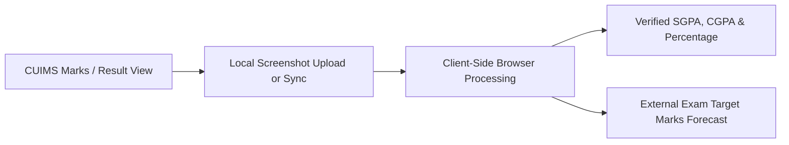

# CUIMS & Chandigarh University — SGPA, CGPA & Marks Predictor

**A privacy-first academic performance engine built specifically for students of Chandigarh University (CU).**  
Calculate credit-weighted semester SGPA, compute multi-semester cumulative CGPA, convert marks to official percentages, and predict exact external examination targets directly in your browser.

 

 

`100% Client-Side Privacy` &nbsp;&bull;&nbsp; `Zero Server Storage` &nbsp;&bull;&nbsp; `Built for Chandigarh University Students`

---

## Product Suite Overview

| Module | Primary Capability | Direct Access |
| :--- | :--- | :--- |
| **CUIMS SGPA & Cumulative CGPA Calculator** | Instant semester SGPA calculation, Sem 1–8 multi-semester cumulative CGPA tracking, and SGPA-to-percentage conversion. | [Open Quick Calculator &rarr;](https://cu-marks-predictor.vercel.app/quick-calculator) |
| **CUIMS Internal Marks & External Grade Predictor** | Detailed course evaluation across Theory, Lab, and Hybrid curricula. Forecasts exact external marks needed for target letter grades. | [Open Internal Predictor &rarr;](https://cu-marks-predictor.vercel.app/internal-calculator) |
| **CUIMS SGPA to Percentage & Grade Scale** | Verified Chandigarh University 10-point credit reference scale (`O` to `F`) with standard percentage conversion metrics. | [View Grade Scale &rarr;](#chandigarh-university-cuims-grading--percentage-scale) |

---

## Interface Showcase

<table>
  <tr>
    <td width="50%" align="center">
      <strong>CUIMS SGPA & Cumulative CGPA Calculator</strong>
        
      
      <!-- Drag & drop screenshot here in GitHub editor: preview-quick-calculator.png -->
       
      <em>Real-time credit-weighted SGPA computation, semester result auto-fill, and multi-semester CGPA tracking.</em>
    </td>
    <td width="50%" align="center">
      <strong>Internal Marks & External Exam Target Predictor</strong>
        
      
      <!-- Drag & drop screenshot here in GitHub editor: preview-internal-predictor.png -->
       
      <em>Weighted internal assessment evaluation with automated external score forecasting for target grades.</em>
    </td>
  </tr>
</table>

---

## End-to-End Student Workflow

---

## Core Capabilities

- **Multi-Semester Cumulative CGPA Tracking:** Combine existing cumulative academic history with ongoing semester marks, or compute across Semesters 1 through 8 simultaneously with credit weightage.
- **Internal-to-External Grade Prediction:** Calibrated for Chandigarh University 1st, 2nd, 3rd, and 4th Year B.E. Computer Science & Engineering (CSE) and allied engineering curricula. Accurately determines the minimum raw external marks needed in final theory and practical papers to secure grades from `O` down to `P`.
- **Local Screenshot & Table Auto-Fill:** Upload or paste raw semester mark sheet screenshots directly into the browser to instantly populate courses, credit hours, and recorded letter grades without manual typing.
- **Privacy-First Architecture:** All calculations, image analysis, and grade predictions are executed locally in the browser runtime. Student names, UIDs, screenshots, and internal marks are never sent to, collected by, or stored on external servers.
- **Responsive & Print-Optimized Layout:** Designed with a clean, low-latency interface that functions smoothly across mobile devices, tablets, and desktop workstations, complete with a clean one-click summary printout.

---

## Chandigarh University (CUIMS) Grading & Percentage Scale

Chandigarh University implements a standard 10-point credit-based grading scale for evaluating undergraduate and postgraduate performance:

| Letter Grade | Performance Classification | Grade Point Value | Percentage Equivalent |
| :---: | :---: | :---: | :---: |
| **O** | Outstanding | **10.0** | 100% |
| **A+** | Excellent | **9.0** | 90% |
| **A** | Very Good | **8.0** | 80% |
| **B+** | Good | **7.0** | 70% |
| **B** | Above Average | **6.0** | 60% |
| **C** | Average | **5.0** | 50% |
| **P** | Marginal Pass | **4.0** | 40% |
| **F** | Fail / Reappear | **0.0** | Below Passing Threshold |

> **Official Percentage Standard:** As per official Chandigarh University academic regulations, the equivalent percentage is calculated as:  
> $$\text{Equivalent Percentage (\%)} = \text{SGPA / CGPA} \times 10$$

---

## Frequently Asked Questions

<strong>How is SGPA and cumulative CGPA computed from CUIMS result screenshots?</strong>

 
Students can upload or paste an image of their official CUIMS semester result view directly into the Quick Calculator. The application reads the course titles, associated credit units, and awarded letter grades entirely inside the browser to deliver immediate, verified SGPA, multi-semester CGPA, and equivalent percentage values.

<strong>How do I convert my CUIMS SGPA or CGPA to an official percentage?</strong>

 
Chandigarh University specifies a direct linear multiplier of 10 for percentage derivation. An SGPA or cumulative CGPA of 7.85 equates directly to 78.50%.

<strong>How does the Internal Marks Predictor calculate required external examination marks?</strong>

 
By taking your ongoing internal assessment marks (Mid-Semester Tests, Surprise Tests, Quizzes, Assignments, and Practical evaluations), the calculator evaluates your current internal weightage against official course passing thresholds and historical grade boundary models. It then computes the exact raw score needed in your final external examination to secure your desired grade.

<strong>Are my CUIMS credentials, marks, or uploaded images sent to any server?</strong>

 
No. The application is built with a zero-telemetry, client-side architectural model. All image processing, table parsing, and grade calculations happen entirely within your local browser memory. No student data ever leaves your device.

---

## Author & Maintainer

Designed, developed, and maintained by:

**Amanjeet Kumar**  
Department of Computer Science & Engineering  
Chandigarh University (CU), Punjab, India  

- **LinkedIn:** [linkedin.com/in/amanjeet233](https://www.linkedin.com/in/amanjeet233/)  
- **GitHub:** [@amanjeet233](https://github.com/amanjeet233)  
- **Live Platform:** [cu-marks-predictor.vercel.app](https://cu-marks-predictor.vercel.app)

---

## Intellectual Property & Proprietary Rights Notice

**Copyright &copy; 2026 Amanjeet Kumar. All Rights Reserved.**

This repository serves exclusively as public showcase documentation and the official portal index for the **CU Marks Predictor** web application.

The underlying software architecture, client-side extraction algorithms, user interface designs, and brand identity are the proprietary intellectual property of **Amanjeet Kumar**.

- **No Public License:** No license (express, implied, or statutory) is granted to clone, duplicate, modify, distribute, scrape, re-host, reverse-engineer, or rebrand any portion of this application or its documentation.
- **Prohibited Conduct:** Any unauthorized mirroring, third-party deployment, or publication under a different name or attribution is strictly prohibited and constitutes an infringement of intellectual property rights.
- **Inquiries & Feedback:** For feedback, academic inquiries, or syllabus revision submissions, please open an issue in this repository.
