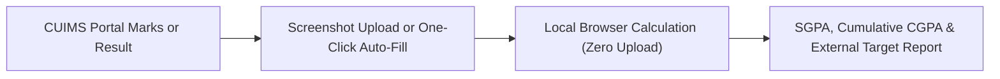

# CUIMS & Chandigarh University — SGPA, CGPA & Marks Predictor

**Instant semester SGPA calculation, multi-semester cumulative CGPA tracking, SGPA-to-percentage conversion, and external exam grade prediction — built exclusively for Chandigarh University students.**

 

  
  &nbsp;&nbsp;
  
  &nbsp;&nbsp;
  

  <strong>100% Client-Side Privacy</strong> &nbsp;&bull;&nbsp; <strong>Zero Server Storage</strong> &nbsp;&bull;&nbsp; <strong>Built for Chandigarh University Students</strong>

---

## Product Suite Overview

| Module | Primary Capability | Direct Access |
| :--- | :--- | :--- |
| **CUIMS SGPA & Cumulative CGPA Calculator** | Credit-weighted semester SGPA from CU letter grades, multi-semester CGPA rollup across Semesters 1–8, and official percentage derivation from a single CUIMS result screenshot. | [Open Quick Calculator &rarr;](https://cu-marks-predictor.vercel.app/quick-calculator) |
| **CUIMS Internal Marks & External Grade Predictor** | Course-wise internal assessment tracking for 1st–4th Year B.E. curricula to compute the exact external marks required for target CU grades (`O` through `P`). | [Open Predictor &rarr;](https://cu-marks-predictor.vercel.app/internal-calculator) |
| **CUIMS SGPA to Percentage & Grade Scale Reference** | Standard Chandigarh University 10-point grading scale, performance tiers, and the official `SGPA × 10` percentage conversion for CUIMS results. | [View Scale &darr;](#chandigarh-university-cuims-grade-point--percentage-scale) |

---

## Application Showcase & Core Views

### 1. Academic Performance Dashboard & Navigation
Comprehensive overview giving students immediate access to the Quick SGPA calculator, CUIMS auto-collection, and the internal marks workflow.

<!-- Drag and drop your image here in GitHub editor: 01-home-dashboard -->

 

### 2. CUIMS Quick SGPA & Cumulative CGPA Calculator
Fast credit-weighted SGPA calculation featuring direct CUIMS result screenshot auto-fill, letter grade selection, and cumulative CGPA rollup.

<!-- Drag and drop your image here in GitHub editor: 02-quick-sgpa-calculator -->

 

### 3. Curriculum & Year Selection (1st – 4th Year B.E. CSE)
Full curriculum selector tailored for Chandigarh University engineering curricula across all 4 academic years, plus standalone calculators for Hybrid, Theory, Practical, and Online exam formats.

<!-- Drag and drop your image here in GitHub editor: 03-internal-year-selection -->

 

### 4. Course-Wise Internal Assessment Entry
Clean, structured component input tracking your Mid-Semester Tests (MST-1, MST-2), Quizzes, Assignments, and Surprise Tests with live weighted totals.

<!-- Drag and drop your image here in GitHub editor: 04-internal-marks-entry -->

 

### 5. Internal Marks Breakdown Summary & Deduction Audit
Detailed audit table itemizing credits, obtained internal marks, maximum caps, and deduction margins before choosing your target SGPA.

<!-- Drag and drop your image here in GitHub editor: 05-internal-breakdown-summary -->

 

### 6. Target SGPA Prediction & External Examination Planning
Algorithmic grade forecasting displaying your estimated SGPA range, relative grading scenarios (Low, Normal, High), and the exact raw marks required on final external exams.

<!-- Drag and drop your image here in GitHub editor: 06-sgpa-prediction-results -->

---

## Student Workflow

---

## Core Capabilities

- **Multi-Semester Cumulative CGPA Tracking** — Real-time synchronization across Semesters 1–8 alongside single-semester SGPA computation.
- **Internal-to-External Grade Prediction** — Supports 1st–4th Year B.E. CSE curricula (including hybrid theory/lab courses and 100-mark evaluation subjects) to determine exact external marks required for target grades (`O`, `A+`, `A`, `B+`, `B`, `C`, `P`).
- **Instant Screenshot & Table Auto-Fill** — Reads CUIMS mark sheets and CUIMS result tables directly in the browser to eliminate manual typing errors.
- **Privacy-First Architecture** — Every calculation and image scan executes locally on the user's device; credentials, marks, and screenshots are never transmitted or stored externally.
- **Responsive & Print-Ready Summary** — Optimized across mobile, tablet, and desktop screens with one-click academic report printing.

---

## Chandigarh University (CUIMS) Grade Point & Percentage Scale

| Grade | Grade Points | Standing |
| :---: | :---: | :---: |
| **O** | 10 | Outstanding |
| **A+** | 9 | Excellent |
| **A** | 8 | Very Good |
| **B+** | 7 | Good |
| **B** | 6 | Above Average |
| **C** | 5 | Average |
| **P** | 4 | Pass |
| **F** | 0 | Fail |

 

> **Percentage Conversion:** `Equivalent Percentage (%) = SGPA or CGPA × 10`  
> *e.g., a CUIMS SGPA of 8.20 equals 82.00%, and a CU CGPA of 7.50 equals 75.00%.*

---

## Frequently Asked Questions

<strong>How do I calculate CUIMS SGPA and cumulative CGPA from result screenshots?</strong>

 
Open the <a href="https://cu-marks-predictor.vercel.app/quick-calculator">CUIMS SGPA & CGPA Calculator</a>, select your academic year, and upload or paste your CUIMS result screenshot. The engine reads subject names, credits, and CUIMS grades locally, fills the semester slots automatically, and computes credit-weighted SGPA plus cumulative CGPA across Semesters 1–8.

<strong>How do I convert CUIMS SGPA or CGPA to percentage at Chandigarh University?</strong>

 
Chandigarh University uses a direct multiplier: <strong>Percentage = SGPA × 10</strong>. A CUIMS SGPA of 7.71 corresponds to 77.10%, and a CU CGPA of 8.20 corresponds to 82.00%. The calculator displays this conversion automatically alongside your results.

<strong>How do external exam target marks work under CU relative grading?</strong>

 
Enter your internal assessment marks per subject in the <a href="https://cu-marks-predictor.vercel.app/internal-calculator">Internal & External Predictor</a>. Using the official assessment weightage for each course, it solves for the minimum raw external marks needed on the end-term exam to reach your target CUIMS grade — whether theory, hybrid, or 100-mark evaluation subjects.

<strong>Is my CUIMS data or marks sent to any server?</strong>

 
No. The application runs 100% in your browser. CUIMS screenshots are processed on-device, marks never leave your machine, and nothing is stored on any external server — no uploads, no accounts, no tracking of academic data.

---

## Author & Maintainer

Designed, developed, and maintained by:

**Amanjeet Kumar**  
Department of Computer Science & Engineering  
Chandigarh University (CU), Punjab, India  

- **LinkedIn:** [linkedin.com/in/amanjeet233](https://www.linkedin.com/in/amanjeet233/)  
- **GitHub:** [@amanjeet233](https://github.com/amanjeet233)  
- **Live Platform:** [cu-marks-predictor.vercel.app](https://cu-marks-predictor.vercel.app)

---

## Intellectual Property & Proprietary Rights Notice

**Copyright &copy; 2026 Amanjeet Kumar. All Rights Reserved.**

This repository serves exclusively as public showcase documentation and the official portal index for the **CU Marks Predictor** web application.

The underlying software architecture, client-side extraction algorithms, user interface designs, and brand identity are the proprietary intellectual property of **Amanjeet Kumar**.

- **No Public License:** No license (express, implied, or statutory) is granted to clone, duplicate, modify, distribute, scrape, re-host, reverse-engineer, or rebrand any portion of this application or its documentation.
- **Prohibited Conduct:** Any unauthorized mirroring, third-party deployment, or publication under a different name or attribution is strictly prohibited and constitutes an infringement of intellectual property rights.
- **Feedback & Inquiries:** For academic feedback, verification inquiries, or syllabus revision submissions, please open an issue in this repository.
