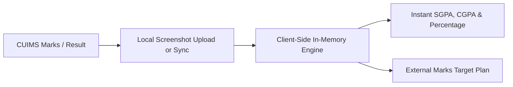

# CUIMS & Chandigarh University
### SGPA, CGPA & Academic Marks Predictor

An executive academic companion engineered for students across Chandigarh University (CU). Calculate credit-weighted semester SGPA, track multi-semester cumulative CGPA, derive verified percentage equivalencies, and forecast external examination grade boundaries—100% locally in your browser.

---

### Direct Portal Access

| Destination | Primary Feature | Link |
| :--- | :--- | :--- |
| **All-in-One Portal** | Complete Chandigarh University Academic Calculator Suite | [**Open Portal &rarr;**](https://cu-marks-predictor.vercel.app) |
| **Quick SGPA & CGPA Calculator** | Instant Semester SGPA, Sem 1–8 Cumulative CGPA & Percentage | [**Launch Quick Calculator &rarr;**](https://cu-marks-predictor.vercel.app/quick-calculator) |
| **Internal Marks & Grade Predictor** | Subject-wise internal assessment evaluation & external marks forecasting | [**Launch Target Predictor &rarr;**](https://cu-marks-predictor.vercel.app/internal-calculator) |

---

## System Architecture & Live Capabilities

| Product Module | Focus & Core Mechanism | Production Access |
| :--- | :--- | :--- |
| **CUIMS SGPA & Cumulative CGPA Engine** | Computes credit-weighted SGPA from grades, supports multi-semester CGPA rollups (Semesters 1 through 8), and auto-derives official university percentage figures. | [**Open Quick Calculator &rarr;**](https://cu-marks-predictor.vercel.app/quick-calculator) |
| **Internal Assessment & Target Forecaster** | Models course assessment components across Theory, Practical, Hybrid, and Online exam formats to calculate required raw external marks for target letter grades (`O` to `P`). | [**Open Target Predictor &rarr;**](https://cu-marks-predictor.vercel.app/internal-calculator) |
| **Official 10-Point Credit Scale** | Standardized Chandigarh University grade point definitions, performance tiers, and linear percentage translation formula. | [**Jump to Scale &rarr;**](#chandigarh-university-cuims-grading--percentage-scale) |

---

## End-to-End Workflow

---

## Key Engineering Highlights

### 1. Multi-Semester Cumulative CGPA Rollup
Combines historical cumulative academic records with ongoing semester credit loads. Students can project target graduation thresholds or verify multi-semester grade progression simultaneously across Semesters 1 through 8.

### 2. Algorithmic Target Grade Forecasting
Evaluates ongoing internal component achievements (MST-1, MST-2, Surprise Tests, Assignments, Quizzes) and determines the exact, minimum raw external score required on final examinations to achieve target grades (`O`, `A+`, `A`, `B+`, `B`, `C`, `P`).

### 3. Automated Document Recognition
Processes raw CUIMS result card screenshots directly inside browser memory. Eliminates repetitive manual data entry by extracting course titles, associated credits, and recorded letter grades instantly.

### 4. Zero-Telemetry Privacy Standard
The entire computational pipeline runs within the local browser environment. No marks, UIDs, screenshots, or identifying tokens are ever transmitted across the network or stored in external databases.

### 5. Multi-Device & Print Optimization
Built with responsive layouts optimized across mobile handsets, tablets, and high-resolution desktop viewports, accompanied by an executive one-click summary printout.

---

## Chandigarh University (CUIMS) Grading & Percentage Scale

Chandigarh University operates a standard 10-point credit grading framework for undergraduate and postgraduate degree curricula:

| Letter Grade | Performance Classification | Grade Point Value | Percentage Equivalent |
| :---: | :---: | :---: | :---: |
| **O** | Outstanding | **10.0** | 100% |
| **A+** | Excellent | **9.0** | 90% |
| **A** | Very Good | **8.0** | 80% |
| **B+** | Good | **7.0** | 70% |
| **B** | Above Average | **6.0** | 60% |
| **C** | Average | **5.0** | 50% |
| **P** | Marginal Pass | **4.0** | 40% |
| **F** | Fail / Reappear | **0.0** | Below Passing Threshold |

> **Official Conversion Standard:**  
> **Equivalent Percentage (%) = SGPA or Cumulative CGPA &times; 10**

---

## Frequently Asked Questions

<strong>How are SGPA and cumulative CGPA derived from CUIMS result screenshots?</strong>

 
Students upload or paste a screenshot of their CUIMS grade report into the Quick Calculator. The client-side engine parses the course titles, associated credit units, and awarded letter grades entirely in browser memory to output credit-weighted SGPA, multi-semester CGPA, and equivalent percentage values immediately.

<strong>How do I compute my official percentage from SGPA / CGPA?</strong>

 
Chandigarh University prescribes a direct multiplier of 10 for percentage derivation. An SGPA or cumulative CGPA of 8.20 corresponds to an official 82.00%.

<strong>How does the Internal Marks Predictor calculate required external marks?</strong>

 
By cross-referencing your ongoing internal assessment marks against course syllabus definitions, internal weights, and relative grade cutoffs, the engine solves for the exact external score needed in end-term theory or practical exams to achieve a target letter grade.

<strong>Are uploaded screenshots or academic marks sent to any remote server?</strong>

 
No. The application is strictly client-side. All processing, calculations, and visual parsing run exclusively within your browser window. Zero student data leaves your device.

---

## Author & Maintainer

Designed, developed, and maintained by:

**Amanjeet Kumar**  
Department of Computer Science & Engineering  
Chandigarh University (CU), Punjab, India  

- **LinkedIn:** [linkedin.com/in/amanjeet233](https://www.linkedin.com/in/amanjeet233/)  
- **GitHub:** [@amanjeet233](https://github.com/amanjeet233)  
- **Production Web Application:** [cu-marks-predictor.vercel.app](https://cu-marks-predictor.vercel.app)

---

## Intellectual Property & Proprietary Rights

**Copyright &copy; 2026 Amanjeet Kumar. All Rights Reserved.**

This repository is maintained strictly as official public documentation and architectural presentation for the **CU Marks Predictor** platform.

The underlying software architecture, client-side extraction algorithms, user interface designs, and brand identity are the proprietary intellectual property of **Amanjeet Kumar**.

- **No Public License:** No license (express, implied, or statutory) is granted to clone, duplicate, modify, distribute, scrape, re-host, reverse-engineer, or rebrand any portion of this application or its documentation.
- **Prohibited Conduct:** Any unauthorized mirroring, third-party deployment, or publication under a different name or attribution is strictly prohibited and constitutes an infringement of intellectual property rights.
- **Feedback & Inquiries:** For academic feedback, verification inquiries, or syllabus revision submissions, please open an issue in this repository.
